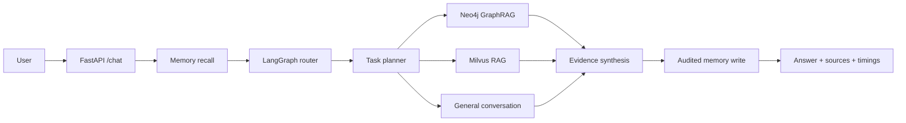

# RiceGod

RiceGod 是一个面向菜谱问答的 GraphRAG + RAG 后端项目。系统使用 LangGraph 做意图路由，使用 Neo4j 存储结构化菜谱知识图谱，使用 Milvus 存储饮食文化长文本向量知识库，并通过 FastAPI 提供统一问答接口。

> 当前定位：可复现的本地作品集项目。还没有用户身份认证，不应直接暴露给不受信任的公网流量，详见 [安全政策](SECURITY.md)。

## 快速演示

```powershell
Copy-Item .env.example .env
# 在 .env 中替换密码和 API Key
docker compose up -d --build
```

启动后打开 http://127.0.0.1:8000 使用内置对话演示页，或打开 http://127.0.0.1:8000/docs 查看 OpenAPI 文档。

菜谱图谱和向量库初始化是显式操作，避免容器每次启动时重复导入：

```powershell
docker compose run --rm recipe-init
docker compose run --rm knowledge-init
```

## 项目亮点

- 基于 LangGraph 的任务编排：识别意图、规划子任务、并行执行独立检索，按依赖结果检索并汇总证据。
- Neo4j GraphRAG：支持菜谱做法、食材、口味、工艺、类型和按条件找菜。
- Graph V2：规范化食材别名，增加食材分类、过敏原、替代关系和来源节点，支持相似菜与过敏原多跳查询；模型与迁移方式见 [Graph V2 设计](docs/graph_v2_design.md)。
- Graph V1/V2 与 JSON 量化评测：24 个固定问题分别衡量 V1→V2 的能力与召回变化，以及原始 `recipe.json`→Graph V2 的总体效果；增强 JSON 用于分离数据治理与查询引擎的收益，结果见 [Graph V2 固定评测](docs/graph_v2_evaluation.md)。
- Milvus RAG：支持菜品历史、典故、菜系文化等长文本语义检索。
- 安全查询：Text2Cypher 查询经过只读校验，禁止写操作关键字。
- 开发兜底：Neo4j 不可用时，菜谱查询可回退到本地 `recipe.json` 检索，便于本地演示。
- 个性化检索：过敏、忌口完整召回，已识别的食材和口味约束同时用于图查询与本地兜底。
- 独立任务条件：多个菜谱需求分别保留食材、口味、数量和详情要求，共同继承全局限制。
- 会话推荐列表：State 保留最近一次推荐的分组与顺序，寒暄、文化查询和详情追问后仍可按序号选择；分组不明确或序号越界时澄清。
- 会话 State 持久化：官方 PostgreSQL Checkpointer 保存消息、任务计划和推荐列表，重启后使用同一用户与会话继续追问。
- 模型上下文管理：完整历史持续保存，模型读取最近对话窗口；按节点控制输入预算，保留推荐编号和相关记忆，更正或遗忘后隔离旧历史。
- 记忆写入确认：根据实际数据库操作确认保存，分别反馈失败、跳过和部分成功，并同步会话历史。
- 记忆调用控制：纯寒暄、纯序号选择跳过提取；混合表达继续检测。明确更正与遗忘在召回前处理，歧义目标澄清。
- 菜谱排序：先过滤硬条件，再按主辅料匹配、耗时、步骤和已表达偏好排序，减少近似结果；默认推荐最多三道，支持明确数量和详情请求。
- 来源追踪：检索任务保留真实记录和来源，通过 `/chat` 返回 `sources`。
- 固定评测与耗时统计：版本化案例检查约束、规划、连续追问和记忆行为，聊天响应返回阶段耗时，评测报告输出平均值、P50/P95、规划回退率及可比较结果。

## 架构

模块职责与资源生命周期见 [模块设计](docs/module_design.md)。`main.py` 处理 HTTP，`ChatService` 管理一轮聊天和记忆确认，Agent 的规划、检索、回答分别实现，`workflow.py` 负责图调度；应用启动时统一创建资源。

会话恢复、配置和 GustoBot 实现对比见 [State 持久化设计](docs/state_persistence_design.md)。

窗口、预算、证据压缩和历史隔离的取舍见 [上下文管理设计](docs/context_management_design.md)。

固定评测、指标分母、阶段计时和复跑命令见 [评测设计](docs/evaluation_design.md)。

简单请求直接规划、复杂请求模型规划与原文范围修复见 [Planner 优化设计](docs/planner_optimization_design.md)。



数据流：

```text
data/recipe.json -> python -m scripts.import_recipes_to_neo4j -> Neo4j
data/data.txt    -> python -m scripts.ingest_food_knowledge_to_milvus -> Milvus
```

`data/excipients.json` 预留为下一阶段食材营养/功效图谱扩展数据，当前核心交付暂不接入。

## 技术栈

- Python 3.10–3.13
- FastAPI / Uvicorn
- LangGraph 1.2.11 / LangChain Core 1.6.3 / LangChain OpenAI 1.6.2
- Neo4j
- Milvus
- PostgreSQL / pgvector / LangGraph PostgreSQL Checkpointer
- OpenAI-compatible LLM and Embedding API
- Pytest

## 运行环境

支持 Python 3.10–3.13。`pyproject.toml` 是顶层依赖的唯一声明，`requirements.lock` 是已验证环境的精确快照。常规开发使用锁文件：

```powershell
python -m venv .venv
.\.venv\Scripts\python.exe -m pip install -r requirements-dev.txt
.\.venv\Scripts\python.exe -m pytest -q
.\.venv\Scripts\python.exe -m uvicorn ricegod.main:app --reload --host 127.0.0.1 --port 8000
```

仅安装顶层生产依赖时，可使用 `python -m pip install .`。

## 配置

复制 `.env.example` 为 `.env`，然后替换所有 `change_me_*` 和 `your_api_key_here`。`.env` 已被 Git 忽略，不要把它复制进镜像或提交到远程仓库。

默认 `CHECKPOINT_BACKEND=postgres`，与长期记忆复用 PostgreSQL；应用启动时自动创建官方 Checkpoint 表。数据库连接或建表失败会使启动失败。仅需临时内存演示时，可显式设置 `CHECKPOINT_BACKEND=memory`，此模式重启不保留 State。

默认本地服务配置：

```env
NEO4J_URI=bolt://localhost:7687
NEO4J_USER=neo4j
NEO4J_PASSWORD=change_me_neo4j
NEO4J_DATABASE=neo4j

MILVUS_HOST=localhost
MILVUS_PORT=19530
MILVUS_COLLECTION=food_knowledge
```

## 启动依赖服务

```powershell
docker compose up -d --build
```

Neo4j Browser: http://localhost:7474

Milvus standalone: `localhost:19530`

PostgreSQL: `localhost:5432`，容器数据卷同时保存长期记忆、消息记录和会话 Checkpoint。

## 导入数据

通过一次性容器导入菜谱知识图谱：

```powershell
docker compose run --rm recipe-init
```

导入饮食文化向量知识库（会调用 Embedding API）：

```powershell
docker compose run --rm knowledge-init
```

需要清空并重建时，在命令末尾显式加上 `--clear`。

## 启动 API

Compose 模式已自动启动 API。本机开发模式可运行 `\.\.venv\Scripts\python.exe -m uvicorn ricegod.main:app --reload --host 127.0.0.1 --port 8000`。

健康检查：

```powershell
curl http://127.0.0.1:8000/health
```

问答接口：

```powershell
curl -X POST http://127.0.0.1:8000/chat `
  -H "Content-Type: application/json" `
  -d "{\"message\":\"香肠炒菜干怎么做\",\"thread_id\":\"demo\"}"
```

返回字段：

```json
{
  "answer": "...",
  "route": "recipe_query",
  "logic": "...",
  "sources": []
}
```

## End-to-End Demo

访问根路径 `/` 可使用内置对话 UI，它会展示路由、来源数和本次请求耗时。完整演示文档：

- [端到端 Demo 流程](docs/end_to_end_demo.md)
- [示例请求与返回](docs/sample_responses.md)
- [演示问题清单](docs/demo_questions.md)

推荐使用 Python `urllib` 调用 `/chat`，避免部分 PowerShell 终端把中文响应显示成乱码。

## 测试

```powershell
.\.venv\Scripts\python.exe -m flake8 ricegod scripts tests
.\.venv\Scripts\python.exe -m pytest tests -q
```

GitHub Actions 在 Python 3.10 下运行语法/未定义名称检查、全量单元测试和真实 PostgreSQL/pgvector 集成测试。

数据库和模型配置完成后，可额外运行真实服务验收（会调用外部模型和 Embedding，产生相应费用）：

```powershell
.\.venv\Scripts\python.exe -m scripts.verify_end_to_end --output docs/end_to_end_verification.json
```

验收脚本使用独立 UUID 测试用户，验证真实菜谱与文化检索、跨会话记忆和用户隔离，完成后仅删除该测试用户的消息、记忆与 Checkpoint。完整结果保存为 JSON，包含实际来源、规划、任务状态和耗时。

真实 PostgreSQL 恢复测试默认跳过，不调用外部模型；启用方式：

```powershell
$env:RICEGOD_TEST_POSTGRES='1'
$env:LANGGRAPH_STRICT_MSGPACK='true'
.\.venv\Scripts\python.exe -m pytest tests -q
```

## 演示问题

见 [docs/demo_questions.md](docs/demo_questions.md)。

## 简历描述

- 基于 LangGraph 构建依赖感知的多任务菜谱问答系统，集成 Neo4j GraphRAG、Milvus 向量检索、证据合成与失败降级。
- 对 19,669 道菜谱进行食材实体规范化和过敏原关系建模，在 24 题固定集上将完全匹配率从 12.5% 提升至 100%、宏召回率从 22.8% 提升至 100%。
- 基于 PostgreSQL、pgvector 和 LangGraph Checkpointer 实现可追溯长期记忆、跨重启多轮会话、更正/遗忘和用户隔离。
- 通过规则优先规划和上下文裁剪，将同一 36 题在线固定集的平均耗时从 9.18 秒降至 4.68 秒，P95 从 18.10 秒降至 8.84 秒。

## Long-Term Memory

The project now includes a lightweight long-term memory module for recipe assistant personalization:

- Raw chat logs in PostgreSQL table `messages`
- Distilled durable memory in PostgreSQL + pgvector table `memories`
- Semantic recall by `user_id` and vector similarity
- Memory-injected prompt for personalized responses
- Extraction from the latest user message only; add/update writes require a verified user quote and retain `source_message_id` and `evidence` for audit
- Full-message rules skip extraction for pure greetings and recipe selections; mixed messages still run extraction
- Explicit correction/deletion runs before recall, validates logged user evidence and target ownership, and confirms actual database outcomes
- Memory management APIs:
  - `GET /memories?user_id=...`
  - `DELETE /memories/{id}?user_id=...`
  - `GET /messages?user_id=...&conversation_id=...`

Design details and extractor prompt:
- `docs/memory_design.md`

提取跳过规则、支持的更正与遗忘句式、结果字段及验收见 [记忆操作设计](docs/memory_operations_design.md)。

任务编排、检索约束、评估结果与当前限制见 [优化设计](docs/optimization_design.md)。设计参考 [GustoBot develop](https://github.com/skygazer42/GustoBot/tree/develop) 的任务规划和结果汇总思路，按 RiceGod 的数据模型重新实现。

菜谱数量规则、排序因素、借鉴依据和真实数据库检查见 [菜谱排序设计](docs/recipe_ranking_design.md)。

## 数据与许可证

源码和项目自建文档使用 [MIT License](LICENSE)。数据文件不会因为放在本仓库中就自动获得 MIT 许可；当前数据来源、处理方式和公开发布状态见 [数据来源说明](docs/DATA_SOURCES.md)。来源或许可未核验的数据不应公开分发。
