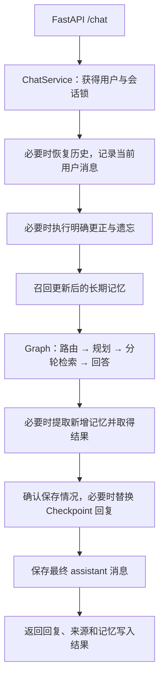

# RiceGod 模块职责与主链路

本轮按职责整理已有后端。HTTP 路径、请求与响应字段、图节点名称和业务规则保持一致；不迁移数据库模型，也没有新增 Agent 层级。

## 模块分工

| 模块 | 负责的事情 |
| --- | --- |
| `ricegod/main.py` | HTTP 参数校验、依赖获取、响应、错误转换和应用生命周期 |
| `ricegod/bootstrap.py` | 在启动时创建菜谱仓库、Graph、记忆组件与 `ChatService`，关闭时释放资源 |
| `application/chat/models.py` | 聊天请求、响应和使用记忆的接口契约 |
| `application/performance.py` | 请求级阶段计时、并行任务区间、回退与状态事件，不进入持久化 State |
| `application/chat/service.py` | 会话串行控制、历史恢复、记忆召回、调用 Graph、取得写入结果、确认回复与保存消息 |
| `application/agents/router.py` | 意图识别，模型失败时回退到规则路由，序号选菜走确定性识别 |
| `application/agents/planner.py` | 规划子任务、校验依赖和覆盖范围、定位用户选择的菜谱、无效计划回退 |
| `application/agents/planning_policy.py` | 识别能直接构造计划的请求，保留复杂请求的模型规划 |
| `application/agents/context.py` | 统一模型输入，按完整轮次裁剪历史、控制预算、保留关键上下文并隔离已失效旧历史 |
| `application/agents/task_conditions.py` | 从用户对应原文构造每个任务的条件，继承全局限制，保留各自数量 |
| `application/agents/workflow.py` | 图节点与边、分发就绪任务、等待依赖、任务超时和故障隔离、每轮临时结果清理 |
| `application/agents/recipe_retrieval.py` | 参数化菜谱查询、候选排序调用、只读 Cypher 校验与重试、本地检索兜底 |
| `application/agents/knowledge_retrieval.py` | 文化检索，依赖菜谱时使用上游实际菜名，缺少证据时阻断 |
| `application/agents/recipe_formatting.py` | 统一格式化菜谱证据、数量不足提示和选择后展开提示 |
| `application/agents/answer.py` | 根据任务证据回答、汇总来源、校验推荐展示顺序并保存推荐快照 |
| `application/agents/recommendations.py` | 推荐分组、序号定位、歧义与范围澄清、推荐快照更新规则 |
| `application/agents/state.py` | 图内任务、结果、状态字段和合并规则 |
| `application/agents/prompts.py` | 路由、规划、回答和查询生成的系统提示词 |
| `application/memory/` | 记忆提取、来源核验、召回、写入结果与成功声明校验 |
| `domain/` | 食材与口味条件、菜谱数量和评分规则，与图调度和 HTTP 无关 |
| `evaluation/` | 版本化固定案例、独立字段与流程判定、耗时统计、报告和比较 |
| `infrastructure/` | Neo4j、Milvus、PostgreSQL、模型接口和数据仓库访问 |
| `infrastructure/checkpoint_store.py` | 官方 PostgreSQL Checkpointer、状态序列化、连接池和异步读写桥接 |

## 一轮聊天的顺序

同一用户、同一会话的锁覆盖整轮流程，避免下一轮抢在记忆确认和历史保存之前执行。不同用户或不同会话可并发。`workflow.py` 只协调图内任务，数据库消息和长期记忆写入留在 `ChatService`。

纯记忆操作和未解决的目标直接生成执行结果并保存 State，不调用回答模型；纯寒暄与纯选择跳过提取，混合表达继续。实现与限制见 [记忆操作设计](memory_operations_design.md)。

每个菜谱任务仍携带自己的 `constraints` 与 `recipe_request`；推荐列表仍属于 Graph State，详情、寒暄和文化查询保留它。回答先去除未经确认的保存声明，再由服务根据实际写入结果确认，返回内容同步到 Checkpoint 和 PostgreSQL。

## 资源与入口

导入 `ricegod.main` 或 `router` 时不创建 Graph、加载菜谱仓库或初始化 PostgreSQL。FastAPI lifespan 启动时调用 `create_runtime()`，将资源放在该应用的 `app.state.runtime`；关闭时释放 Checkpointer 连接池、Neo4j 客户端并移除应用引用。启动或 Graph 构建失败也释放已创建资源。默认 PostgreSQL Checkpointer 初始化失败会阻止启动；它成功后，记忆组件单独初始化失败仍保留查询能力，记忆管理接口返回 503。

长期记忆与原始消息的 PostgreSQL 连接按每次操作关闭；Checkpointer 使用应用持有的连接池，关闭应用时释放。文化检索仓库在检索结束时关闭，LLM 客户端按调用构造。`Runtime` 通过 `ExitStack` 管理长期组件，关闭操作可重复调用。

HTTP 入口保持 `python -m uvicorn ricegod.main:app`。独立测试可以通过 `create_app(runtime_factory=...)` 注入资源，服务测试直接构造 `ChatService(graph, store, memory_service)`，不再修改接口文件里的全局变量。

终端 Graph 演示移到 `python -m ricegod.cli`；原 `python -m ricegod.application.agents.router` 入口仍转交该演示。此入口直接演示图内流程，完整记忆确认链路通过 `/chat` 验证。

真实验收脚本在 TestClient 启动后从 `app.state.runtime` 获取当前资源；关闭后只清理该轮 UUID 测试用户的数据。

## 验证与边界

严格 Msgpack 模式下最新全量回归 **257 项通过**，其中 8 项使用真实 PostgreSQL（通过 `RICEGOD_TEST_POSTGRES=1` 启用）。覆盖模块生命周期、错误转换与会话并发、数据库失败、迁移失败释放资源、异步调用不阻塞事件循环、新连接池与新 Graph 状态恢复、上下文管理，以及请求级计时隔离、并行跨度和固定评测。实际 HTTP 计时与连续追问验收 **13/13** 项通过，详见 [固定评测设计](evaluation_design.md)。

模块整理后的真实服务检查：

| 验收 | 结果 | 记录 |
| --- | --- | --- |
| 完整接口与模型、数据库链路 | 50/50 | [端到端验收](module_end_to_end_verification.json) |
| 每个任务独立条件、记忆保存确认和受控写入失败 | 14/14 | [任务与记忆验收](task_memory_verification.json) |
| 连续选择、文化查询后选择、分组与范围澄清 | 29/29 | [推荐追问验收](recommendation_followups_verification.json) |
| 重启后真实 TCP 连续四轮对话 | 4/4 | [HTTP 验收](recommendation_followups_http_verification.json) |

验收使用独立 UUID 虚构用户，模型、Embedding 和正常数据库检索均为实际调用；记忆专项的最后一轮仅对该用户注入写入失败。所有验收用户的消息和记忆已清理。完整接口验收包括跨用户消息访问、记忆查询和删除拒绝，不能据这些固定案例声称总体问答准确率。

模块整理改善代码职责和可测试性，不代表回答准确率提高。会话已接入 PostgreSQL Checkpointer，消息和结构化推荐快照可跨重启恢复；显式 `memory` 模式仍会丢失 State。实现与独立重启验收见 [State 持久化设计](state_persistence_design.md)。会话锁仍只协调单个进程；记忆写入、Checkpoint 更新与消息保存仍不是跨系统事务。
