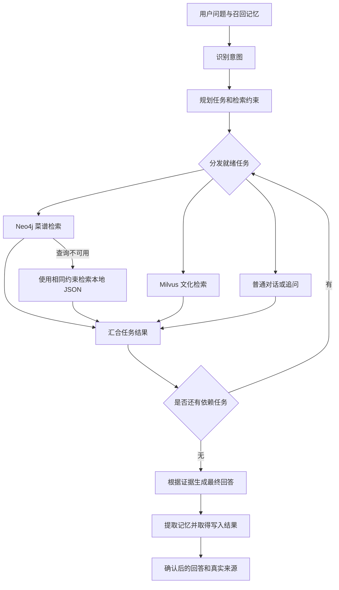

# RiceGod 任务编排与个性化检索优化

本次在 RiceGod 现有后端上改进任务执行和检索，不迁移到另一套项目。框架保持 LangGraph 1.2.11，接口、Neo4j 菜谱图谱、Milvus 饮食文化知识库和 PostgreSQL 用户记忆继续使用当前数据模型。

## 借鉴依据与实施范围

参考 [GustoBot develop](https://github.com/skygazer42/GustoBot/tree/develop) 的 Planner、Send 分发和结果汇总设计。2026-09-18 重新读取 develop 的 `components/planner/node.py` 和 `components/summarize/node.py`，与本地审阅副本内容一致。RiceGod 使用自己的任务模型和检索实现，没有复制 GustoBot 的业务节点。

采用的部分：结构化子任务、明确依赖、图内并行执行、统一检索结果、来源传递和独立的最终回答节点。实现依照 [LangGraph Graph API](https://docs.langchain.com/oss/python/langgraph/graph-api) 的 `Send`、reducer 和 `Overwrite` 接口。

本次范围限定为菜谱、饮食文化和长期记忆，其他业务模块未加入。

## 原问题与新行为

| 原行为 | 新行为 |
| --- | --- |
| 一个节点对多个路由分别生成回答，再合并回答 | 检索任务只返回证据，由独立节点统一生成最终回答 |
| 多个路由使用同一个完整问题 | Planner 为每项任务生成检索问题，失败时用确定性规划兜底 |
| “推荐菜并介绍它的来历”可能同时执行，两边没有共同菜名 | 文化任务可以依赖菜谱任务，使用菜谱结果中的真实菜名 |
| 记忆主要注入回答提示词 | 明确忌口进入结构化检索条件，同时用于图查询和本地兜底 |
| 查询模板可能提前返回，遗漏食材或其他组合条件 | 所有识别到的条件组合后，再执行 LIMIT |
| 过敏、忌口与其他记忆争抢 top-k | 单独完整召回过敏和忌口，再合并语义召回结果 |
| Checkpoint 与消息历史只按会话隔离 | Checkpoint 使用用户与会话组成的 JSON key，消息查询同时过滤用户与会话 |
| API 的 sources 常为空 | 来源从检索任务传到最终状态，再进入 ChatResponse |
| 多实例 Milvus 检索共用 default 连接 | 每个实例使用唯一连接别名，只关闭自己的连接 |
| 匹配菜谱按字序截取，缺少推荐排序 | 硬条件过滤后，按主辅料匹配、耗时、步骤和偏好取候选，再去重和选择 |
| 改写子任务可能改变推荐数量 | 原始问题决定数量，默认最多三道；用户选择第二道后可展开该菜详情 |
| 多个菜谱任务共用所有食材、口味和数量 | 每个任务携带独立条件和数量，从用户对应原文提取，继承共享条件 |
| 回答先声称“已记住”，随后写入可能失败 | 写入后根据实际结果确认，再同步最终回复到 Checkpoint 和 PostgreSQL |

## 执行流程

实现按职责拆分为 HTTP、聊天服务、意图路由、规划、检索与回答模块，图文件保留调度和故障隔离。资源在 FastAPI lifespan 启动时创建，避免导入路由模块即初始化数据库与 Graph。文件分工、调用顺序和生命周期见 [模块设计](module_design.md)。

整理后的完整真实链路再次通过 **50/50** 项检查，结果另存为 [模块整理验收](module_end_to_end_verification.json)，包含记忆保存与召回、两类检索、推荐数量与连续选择、接口用户隔离和删除拒绝。任务与记忆专项 14/14、推荐追问专项 29/29、重启后 TCP 四轮对话 4/4 同样通过。



Planner 输出 `QueryPlan`：最多四项 `PlannedTask`。每个菜谱任务包含当前用户消息的连续原文 `source_text`、独立的 `constraints` 和 `recipe_request`；从原文重新构造条件，不采用模型改写后的食材和数量。任务必须覆盖已路由的意图，id 唯一，依赖只能指向更早的任务。多个菜谱任务的原文不得重叠或缺失；无效计划回退到规则规划。明确的早餐、午餐、晚餐分隔可由规则拆分，并补全模型截短原文时遗漏的局部数量；任意复杂表达仍依赖模型拆分。

未属于某个菜谱任务的用户要求视为共同条件，召回的过敏与忌口也进入每个任务。明确的过敏声明共同生效；局部的“早餐不要土豆、不吃辣”不会影响晚餐任务。各自的数量优先于“各推荐一道”等共同数量。单个菜谱任务使用完整原始问题，保留联合食材要求。为兼容现有调用，`QueryPlan.constraints` 和 `recipe_request` 在单任务时保留原行为；多任务检索与最终回答使用各自任务字段。

规则规划可识别“它、这道菜、这些菜、所推荐”这类明确依赖提示；更复杂的指代由模型规划处理。真实模型与数据库验收的具体案例见下方端到端记录，少量案例不能代表任意复杂指代的效果。

`TaskResult` 区分 `ok`、`empty`、`degraded`、`failed`、`blocked`，保存原始记录、内容和来源。每个任务有独立时间限制，失败保留其他任务的结果。菜谱为空时，依赖它的文化任务不猜测菜名。

任务结果使用字典 reducer 汇合。每轮新请求用 `Overwrite({})` 清空上一轮临时结果；只有最终回答追加到对话消息，避免中间回答污染历史。

最近一次展示的推荐另存于 State 的 `last_recommendations`，按任务计划顺序分组、按记录顺序编号。寒暄、文化查询、菜谱详情保留该字段；新的非空推荐列表替换它。序号定位使用该字段，多个分组未指定哪一组、序号越界或没有列表时澄清。实现与持久化边界见 [连续追问设计](recommendation_context_design.md)。

连续追问真实验收见 [验收记录](recommendation_followups_verification.json)：13 轮对话、29/29 项检查通过。覆盖寒暄后选择、展开第二道后继续选择第三道、真实 Milvus 查询后继续选菜、新的早餐/晚餐分组替换旧列表、分组歧义和越界澄清、跨会话隔离；每轮核验响应与消息历史一致，测试用户已清理。

## 检索与记忆边界

`RecipeConstraints` 支持菜名、必需食材、排除食材、口味、工艺、菜品类型和不吃辣。图查询使用参数化条件，检查主食材与辅料；本地 JSON 使用相同领域规则，在截取结果前过滤。

菜谱推荐增加 `RecipeRequest`，保留原始问题、数量、详情请求和可识别偏好。Neo4j 先评分再取最多 60 条候选，Python 完成去重和差异化选择；本地兜底共享评分规则。默认最多三道，明确数量按要求处理，单次最多十道。规则、GustoBot 借鉴依据和限制见 [菜谱排序设计](recipe_ranking_design.md)。

规则提取优先匹配最长已知实体；单字忌口必须处于明确限制语境，避免把“不要香菜”错误扩展成“不要菜”。类型为 allergy 和 disliked_ingredient 的记忆作为明确限制处理。普通菜系喜好、目标和设备不会被臆造为图谱字段。

这些过滤依赖数据里的食材名称和口味字段，没有食材别名、本体分类、交叉污染等完整信息。不能把“本次返回记录符合已识别字段条件”描述成覆盖所有饮食或过敏风险。

生成 Cypher 的校验失败最多重试两次，修复结果再次校验后才执行。执行失败回退到本地证据；数据库返回空结果保持空结果。图谱查询使用 READ_ACCESS、10 秒查询超时，最多向应用返回 10 行。关键词校验和 READ_ACCESS 不能替代数据库账户的只读权限，也不等同于完整语法验证。

过敏、忌口记忆不再受语义 top-k 限制；合并后 `used_memories` 数量可能大于 `MEMORY_TOP_K`。补充召回的限制记忆 score 为 0，不伪造语义相似度。

记忆提取仅使用本轮用户消息，要求消息 id 和连续原话证据，并由提取器、服务和数据库校验。新增与更新均固定保存核验后的候选原话，不采用工具扩展的内容；助手推荐葱香菜式不能成为用户喜欢葱香的证据。普通工具协调只允许新增或不操作；明确更正、遗忘独立核验并在召回前执行。Embedding 召回调用失败时，改用该用户最近保存的记忆，并完整补充过敏、忌口，score 为 0。新记忆的向量写入仍依赖可用的 Embedding 服务。

仅提取本轮消息避免中性后续问题重新提取旧事实。明确单条更正和遗忘已实现，详见 [记忆操作设计](memory_operations_design.md)；任意改写、跨轮指代、批量操作和删除标记仍需专项改进；当前没有完成 LangGraph 原生 Store 迁移。原话核验不保证类型和语境理解正确；旧记忆没有自动审查或补造来源，详见 [记忆设计](memory_design.md)。

## API 兼容与运行配置

`/chat` 请求和响应字段保持兼容，继续支持 `thread_id` 作为 `conversation_id` 的别名。用户与会话最长各 128 字符。

以下管理接口现在必须传 `user_id`，缺少时返回 422：

- `GET /messages?user_id=u1&conversation_id=c1&limit=200`
- `DELETE /memories/123?user_id=u1`

这里实现的是按调用方提供的用户 id 隔离数据，还没有身份认证。单进程内同一用户会话的聊天串行执行；多进程部署仍需共享持久 Checkpointer 和并发协调。

新增配置：

- `LLM_TIMEOUT_SECONDS=60`：模型请求超时，路由、规划、最终回答与记忆模型统一使用。真实完整分类请求曾耗时 23.43 秒，原固定 20 秒会触发超时。
- `LLM_ENABLE_THINKING`：默认不传此参数。兼容的通义模型可设置为 `false`；其他模型保持未设置。当前 Qwen 模型已验证可关闭思考模式，固定虚构案例的独立记忆提取耗时 2.46 秒。参数依据见 [阿里云结构化输出文档](https://docs.modelstudio.console.alibabacloud.com/zh/model-studio/qwen-structured-output)。
- `AGENT_TASK_TIMEOUT_SECONDS=45`：每个执行任务的超时。
- `CYPHER_MAX_ATTEMPTS=2`：生成查询因只读校验失败时的尝试上限，允许 1–3。

同步数据库、Embedding 和重排检索移到线程执行，减少对事件循环的阻塞。模型客户端默认 60 秒超时，Embedding 客户端为 20 秒，两者均允许一次客户端重试。执行任务仍受独立的 45 秒限制，必要时可按模型延迟调整。线程任务取消并不会强制终止底层同步调用，因此仍需依靠客户端和数据库自身的超时。

记忆提取仍在答复返回前等待完成，以便下一轮能读取已写入的记忆；本次没有新增持久后台任务队列。

## 可复现验证

独立环境运行：

```powershell
.\.venv\Scripts\python.exe -m pytest -q -p no:cacheprovider
.\.venv\Scripts\python.exe -m scripts.evaluate_recipe_constraints --output docs/recipe_constraint_evaluation.json
```

新增回归覆盖：独立任务并行启动、依赖顺序、单任务故障与超时、下一轮结果清理、无效计划回退、生成 Cypher 修复后的重新校验、最终回答接收真实证据、组合条件过滤、辅料中的辣椒、用户隔离、完整限制记忆召回，以及管理接口缺少用户 id。

当前独立环境的全量回归结果为 **257 passed**，其中 8 项真实 PostgreSQL 集成用例通过 `RICEGOD_TEST_POSTGRES=1` 启用。覆盖记忆来源核验与污染防护，以及排序、推荐数量、规划器改写、去重、图查询候选截取、兜底一致性和连续追问。模块生命周期、会话并发、持久化失败处理、跨连接池状态恢复、上下文管理与固定评测用例均通过。剩余三个 warning 来自第三方库的弃用提示。该轮启用 `LANGGRAPH_STRICT_MSGPACK=true`，Checkpoint 显式允许本项目的状态与任务类型，包括 `RecipeRequest` 和 `RecommendationGroup`。默认运行时已接入官方 PostgreSQL Checkpointer，真实 HTTP 中途重启验收 19/19 项通过，详见 [State 持久化设计](state_persistence_design.md)。最新固定评测与耗时统计见 [评测设计](evaluation_design.md)。

2026-09-18 在 19,669 道本地菜谱上，用五组手写案例比较原评分检索与约束检索：

| 指标 | 原评分检索 | 约束检索 |
| --- | --- | --- |
| 返回菜谱条数 | 25 | 18 |
| 符合案例指定字段的条数 | 8 | 18 |
| 返回记录字段满足率 | 32% | 100% |
| 有返回结果的案例数 | 5/5 | 5/5 |

完整案例、提取条件和返回菜名见 [评估记录](recipe_constraint_evaluation.json)。期望条件由案例独立指定，不直接使用提取结果作为判断标准。该结果仅检查五组案例的本地字段条件，不衡量召回率、LLM 回答质量、记忆提取质量或总体问答准确率。

2026-09-18 后续启动了 Docker 依赖，导入 Neo4j 的 19,669 道菜谱，以及 Milvus 的 26 个文化文本片段（初次使用 text-embedding-v4，1024 维）。真实模型与数据库链路曾通过记忆保存、跨会话召回、忌口过滤、文化检索、依赖任务和用户隔离检查。

此前菜谱排序版本的完整验收见 [端到端记录](end_to_end_verification.json)，通过 FastAPI TestClient 调用真实接口处理器，没有替换模型或检索结果，**50/50 项检查通过**。覆盖记忆保存与类型分离、跨会话召回、忌口进入查询条件、Neo4j 检索、Milvus 检索、文化任务使用上游真实菜名、用户隔离和跨用户删除拒绝。逐轮核验来源证据，用户明确表达喜欢葱香能够保存新偏好且保留原忌口；新增默认三道、明确五道、实际回答展示候选和选择第二道后展开详情的验收。

独立任务条件与记忆确认的专项验收见 [最新专项记录](task_memory_verification.json)，**14/14 项检查通过**。前三轮使用真实模型、Embedding、Neo4j 和 PostgreSQL，分别检查保存确认、早餐鸡蛋两道/晚餐土豆一道、早餐不吃辣/晚餐麻辣的条件隔离；最后一轮对唯一虚构测试用户注入 memory INSERT/UPDATE 失败，模型和其他数据库调用仍为真实服务。每轮检查返回回复、Checkpoint 与 PostgreSQL assistant 消息一致，测试用户数据已清理。此记录检验具体案例的流程与字段，不代表总体语义理解准确率。

重启后真实 TCP `/chat` 的两轮专项复测见 [HTTP 验证记录](task_memory_http_verification.json)，**7/7 项检查通过**：保存确认对应数据库真实记录，早餐鸡蛋两道与晚餐土豆一道通过实际 Neo4j 字段核验，所有选中菜谱均出现在回复中，HTTP 回复与消息历史一致。测试用户数据已清理。

此前 text-embedding-v4 返回 `403 insufficient_quota`，随后配置的 qwen3.7-text-embedding 返回 `403 AccessDenied.Unpurchased`。用户修正后，当前使用 qwen3.7-text-embedding-flash，真实调用返回 1024 维向量，记忆保存与文化检索均通过。本轮八组接口案例耗时分别为 19.01、11.85、12.13、13.27、11.93、12.16、16.98、12.18 秒，只代表该轮运行，不是通用性能指标。

更换 Embedding 模型时，同维度不代表向量空间相同。本次已将 26 个文化片段用当前模型重新向量化到 `food_knowledge_qwen37_flash_1024`，更新本机 collection 配置，并保留原 `food_knowledge` 集合。切换时 PostgreSQL 记忆表为空，不涉及旧用户记忆向量迁移；以后如有旧记忆，需按选定模型重建。

另有重启后的真实 TCP `/chat` 两轮检查通过：虚构用户请求含鸡蛋的家常菜，默认返回三道；随后选择第二道，准确返回其材料与步骤。均返回 HTTP 200、recipe_query 和真实 `neo4j:Dish:` 来源，耗时分别为 17.85、12.19 秒。API 已按当前配置重新启动。全部验收用户的 PostgreSQL 消息和记忆均按独立 UUID 清理，未清空业务表。

模型正常返回仍不保证每次规划有效；无效任务依赖已触发规则回退。文化回答依赖项目原始文本，未进行史实审核，也未完成总体回答质量评估。验收关闭可选 LangSmith 上传；环境中观察到追踪上传连接错误，该外部上传链路不属于本次通过项。
