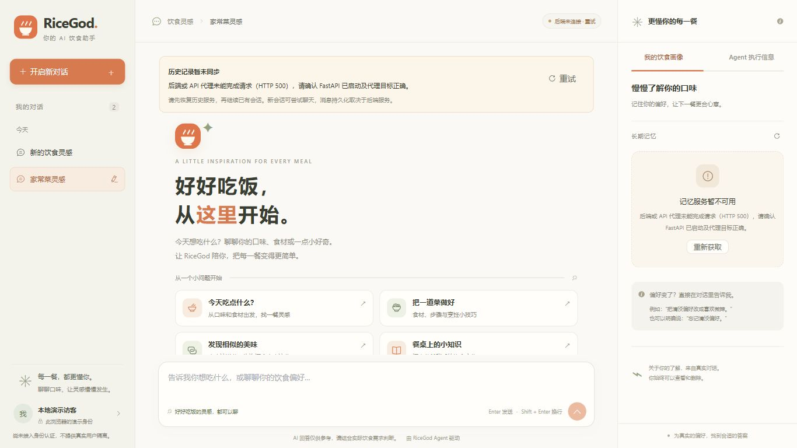
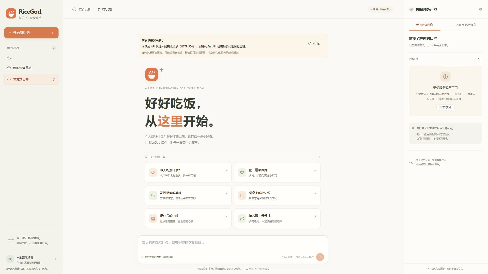

# RiceGod 新前端开发与验收报告

日期：2026-10-15（Asia/Shanghai）。本次交付完成两个阶段的前端实现，完整真实服务端到端验收受本机服务环境限制，不能据构建或单元测试推断联调通过。

## 范围与源码依据

本次只新增 `frontend/` 下的工程、测试和文档。未修改原有静态页面、FastAPI、LangGraph、Agent、RAG、Memory、数据库结构、Docker 或根目录配置。开始时仓库已有大量未提交的后端与文档变更，未覆盖或回滚。

直接阅读并核对：

- `ricegod/main.py`：真实路由、查询参数、依赖与错误状态。
- `ricegod/application/chat/models.py`：ChatRequest、ChatResponse、UsedMemory、DeleteMemoryResponse。
- `ricegod/application/chat/service.py`：对话上下文、幂等请求、错误/持久化流程与 performance 赋值。
- `ricegod/application/memory/models.py`：MessageRecord、MemoryRecord、MemoryWriteResult、操作回执。
- `ricegod/infrastructure/memory_store.py`：begin_turn 唯一键、内容一致性、已完成缓存、失败重试、会话锁、消息查询与删除。
- `ricegod/application/memory/operations.py`：明确的记忆更正与遗忘命令。
- `ricegod/application/performance.py`：total_ms、stages、events、trace_id。
- `ricegod/bootstrap.py`、`checkpoint_store.py` 的启动约束，以及现有 API 测试。

## 新增文件清单

所有文件均位于 `frontend/`，没有修改其他路径下的已有文件。

| 类别 | 文件 |
| --- | --- |
| 工程与独立配置 | `package.json`, `package-lock.json`, `tsconfig.json`, `vite.config.ts`, `index.html`, `.gitignore`, `.env.example` |
| 应用入口 | `src/main.ts`, `src/App.vue` |
| 接口与类型 | `src/api/client.ts`, `src/types/api.ts` |
| 主题与 Markdown 样式 | `src/styles/theme.css`, `src/styles/markdown.css` |
| 共用组件与健康检查 | `src/components/SourceList.vue`, `src/composables/useHealth.ts` |
| 会话 | `src/features/sessions/SessionSidebar.vue`, `src/features/sessions/useSessions.ts` |
| 聊天 | `src/features/chat/ChatWorkspace.vue`, `src/features/chat/MessageBubble.vue`, `src/features/chat/useChat.ts`, `src/features/chat/markdown.ts` |
| 记忆 | `src/features/memory/MemoryPanel.vue`, `src/features/memory/useMemory.ts` |
| Agent | `src/features/agent/AgentPanel.vue` |
| 资源 | `public/ricegod.svg` |
| 测试 | `tests/chat.test.ts`, `tests/memory.test.ts`, `tests/sessions.test.ts`, `tests/markdown.test.ts` |
| 文档与截图 | `README.md`, `docs/DEVELOPMENT_REPORT.md`, `docs/screenshots/desktop-1366x768.jpg`, `docs/screenshots/desktop-1920x1080.jpg` |

`node_modules/`、`dist/` 和本机 `.qa/` 安装缓存被独立 `.gitignore` 排除。锁文件用于可重复安装。

## 功能和真实 API 映射

| 已实现功能 | 真实 API / 字段 | 行为 |
| --- | --- | --- |
| 创建/切换/高亮/本地重命名会话、刷新恢复目录 | 无会话目录 API | 仅保存本浏览器的 ID 与必要元数据；没有虚构接口 |
| 发送、多轮上下文 | `POST /chat`：`user_id`, `conversation_id`, `request_id`, `message` | 同会话固定 ID，每个新轮次独立请求 ID；无模拟流式 |
| 回答展示 | `ChatResponse.answer` | 安全 Markdown、有序列表、代码块、引用、表格 |
| 恢复消息历史 | `GET /messages?user_id=…&conversation_id=…&limit=1000` | 后端返回数组，读取 role/content/created_at；错误有单独提示 |
| RAG/图检索参考来源 | `ChatResponse.sources: string[]` | 有来源才展示；只将 HTTP(S) 字符串变成安全链接，不补造 URL 或分数 |
| 长期记忆分组、刷新 | `GET /memories?user_id=…` | 真实 type/content、时间、id、evidence；故障状态与空记录区分 |
| 记忆删除 | `DELETE /memories/{memory_id}?user_id=…`，`deleted` | 二次确认，禁止重复点击，操作后重新 GET；false 不显示成功 |
| 记忆更正/遗忘 | `POST /chat` 内明确自然语言指令 | 使用已有 operations 逻辑；没有新增写入 API |
| 任务路由 | `route`, `logic` | 显示实际路由值及后端说明；多路由按 `+` 拆分标签 |
| 使用的长期记忆 | `used_memories` | 展示真实内容、类型、ID 和实际记忆召回 score；不称其为 RAG 分数 |
| 记忆写入结果 | `memory_write` | 回执状态、数量、提取状态、跳过/失败原因和操作反馈；可展开完整回执 |
| 执行耗时、阶段与调试事件 | 可选 `performance` | 只显示已返回的 total_ms/stages/events/trace_id；没有模拟节点或 DAG |
| API 连通状态 | `GET /health`：status/service | 只说明 HTTP API 可访问，不将其当成数据库和模型的全面健康检查 |

错误集中由 `errorMessage` 转换，POST 不自动重试。会话状态按 conversation_id 隔离，历史加载带版本号；旧请求只更新原会话。发送阻止重复提交；新会话欢迎页包含六种推荐问题。输入法组词保护、Enter/Shift+Enter、智能滚动和“回到最新”已实现。

## 已执行验证

### 自动检查

- `npm run typecheck`：通过。
- `npm run build`：通过，执行 vue-tsc 和 Vite 生产构建，生成 `dist/`。
- `npm test`：15 项测试通过，4 个测试文件。覆盖重复发送、会话切换时延迟回答的归属、历史请求竞态、首次加载失败的响应性、每轮请求 ID、更安全的手动重试、持久化不可用时禁止重发、记忆错误/未确认删除、会话目录恢复/存储故障/损坏、Markdown XSS 和不安全 URL。
- 单元测试使用受控的契约 fixture 和 API mock，**只验证前端逻辑，不代表真实模型、数据库或检索服务通过验收**。应用代码中没有 mock、演示回答、假来源或成功回退数据。

最初 npm 被环境的离线设置及本地代理连接重置阻止；仅在安装命令中关闭离线模式并绕过该代理后，完成官方 npm 源安装。未更改系统代理。构建/测试的 esbuild 子进程在默认沙箱中遇到 EPERM，使用批准后的标准命令完成检查。

### 浏览器真实操作

浏览器访问真实 Vite 应用和真实代理路径，没有拦截 API 或注入成功响应。

- **1366×768 与 1920×1080**：检查三栏布局、输入框可见、无页面横向溢出。短屏内容在中栏独立滚动；后端故障通知占据额外空间时，部分推荐入口需要滚动。截图中的服务不可用状态是真实环境结果。
- 新建第二个会话：目录计数与当前选择正确。
- 本地重命名为“家常菜灵感”，刷新页面后名称和选中会话正确恢复。
- 切换两个会话：界面与输入状态互相独立；旧会话的失败内容未出现在新的会话中。
- 推荐问题填入输入框；Shift+Enter 插入换行、不提交；Enter 尝试真实 POST。
- 后端不可用：显示明确失败提示，没有生成假回答；输入框禁止继续重复提交。
- 对发送前持久化未验证的失败轮次点击重试：阻止重发，显示原因。
- Agent 标签页在没有实际 ChatResponse 时显示说明，没有模拟执行节点。
- 记忆查询失败显示服务错误，未显示“没有记忆”。

### 真实 FastAPI 启动尝试

执行项目现有 `.venv/Scripts/python.exe -m uvicorn ricegod.main:app --host 127.0.0.1 --port 8000`。FastAPI 0.141.1 可导入，但 lifespan 初始化 checkpointer 时，PostgreSQL `localhost:5432` 连接超时，抛出 `psycopg_pool.PoolTimeout`，启动失败退出。Docker 命令存在，但 Docker Desktop Linux daemon 的命名管道不可用。

因此以下项目 **尚未完成真实端到端验证**：

1. `/chat` 成功回答与真实多轮语义上下文。
2. 成功回答后从 PostgreSQL 恢复消息。
3. 真实长期记忆查询、提取、更正、遗忘和删除。
4. 模型产生的真实 route/sources/used_memories/memory_write/performance 在界面上的完整渲染。
5. 完整 Neo4j、Milvus、PostgreSQL、LangGraph 与模型服务运行回归。

这些对接已按源码实现，但不能宣称已联调成功。未禁用后端启动约束、替换运行时或用假服务让检查通过。

## 后端限制与未增加的功能

- 没有会话目录/重命名接口：目录仅覆盖当前浏览器创建的会话；清除浏览器数据会丢失目录与演示身份。不会从未知 API 扫描数据库中的其他会话。
- `/messages` 仅返回最近消息，最多 1000 条，没有游标/offset。达到上限时显示截断提示，没有虚构分页。
- `/messages` 不返回 request_id、轮次状态、ChatResponse、来源或执行元数据：刷新后只恢复消息文本，历史来源与执行详情不会被伪造。相同页面内新收到的回答可查看详情；重新从历史同步时不重建这些信息。
- `/chat` 不是流式：采用等待状态，不使用定时器逐字输出。
- `performance` 可缺失：缺失就隐藏耗时/阶段；未返回任务 DAG、完整计划或 RAG 分数，不做推测。
- `/health` 不检查所有下游服务，前端提示其能力边界。
- 没有认证与请求能力/轮次状态查询接口：无法证明跨重启、跨数据库切换情况下的 exactly-once；重试的具体保护与副作用边界见启动文档。刷新后不恢复/重放失败请求。
- 后端允许部分 legacy MemoryType 读取；只有实际支持的类型可经后端规则写入。前端不新增写接口。
- 当前只针对桌面布局；无移动端抽屉、Router、Pinia、SSR、登录或其他新业务功能。

如后续扩展后端，可考虑受认证保护的会话目录、消息分页、轮次状态/幂等能力查询，以及持久化的来源与执行元数据接口。本次未实施任何后端变更。

## 环境恢复后的人工验收

1. 按现有后端文档启动 PostgreSQL、Neo4j、Milvus 和模型/embedding 服务，再启动原 FastAPI；确认 `GET /health`，并独立确认 `/messages` 与 `/memories` 可用。
2. `npm ci` 后运行 `npm run dev`，打开 `http://127.0.0.1:5173/`；确认历史与记忆服务不再显示错误。
3. 发送“推荐三道简单家常菜”，追问“第二道怎么做”；核对网络请求的 conversation_id 相同、request_id 不同及回答关联正确。
4. 新建另一会话并切回，刷新页面核对真实历史恢复。
5. 告知明确的长期偏好，检查 memory_write 和记忆列表。删除一条测试记忆时先取消、再确认，核对 DELETE 及之后的 GET 结果。请只使用专门的测试记忆。
6. 查看回答来源和 Agent 面板，与 Network 中真实响应逐项对照；没有返回的内容应隐藏。
7. 发送过程中切换会话，确认返回不会污染当前会话。临时中断连接后检查错误提示，并按文档的幂等边界验证手动重试。
